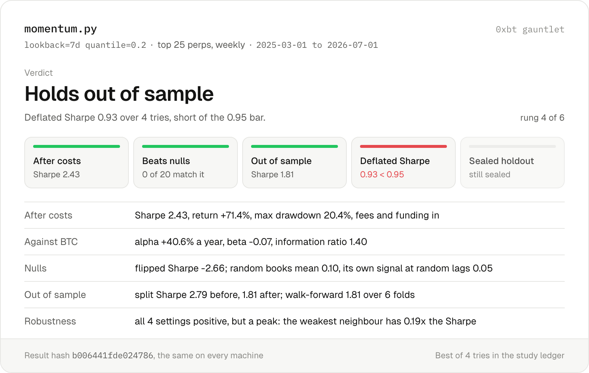
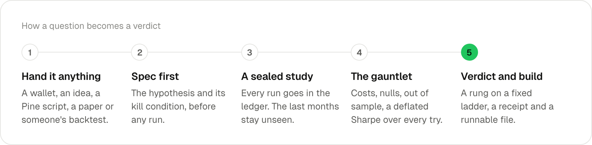

<div align="center">

<picture>
  <source media="(prefers-color-scheme: dark)" srcset="assets/readme/hero-dark.svg">
  
</picture>

<a href="https://github.com/0xArchiveIO/0xarchive-quant/actions/workflows/engine.yml"></a> <a href="https://pypi.org/project/0xarchive-backtest/"></a>    

[Start here](#start-here) · [Install](#install) · [How it works](#how-it-works) · [The verdict](#the-verdict) · [Showcases](#showcases) · [Market data skill](#market-data-skill-0xarchive) · [Docs](https://docs.0xarchive.io)

</div>

Hand your coding agent a wallet, a trading idea, a Pine script, a paper or someone else's backtest. It comes back the way a careful quant desk would: a spec, the cheapest evidence first, a backtest with every cost in, and a verdict read off fixed rules, with a receipt anyone can rerun.

```text
/0xarchive-backtest is 7-day momentum on the top 25 perps real, or luck?
```

<div align="center">

<picture>
  <source media="(prefers-color-scheme: dark)" srcset="assets/readme/card-dark.png">
  
</picture>

</div>

## Start here

Pick the row that matches how you want to work.

| You want to | Start with | You need |
|---|---|---|
| Ask in plain words and let your coding agent run the tests | [Install](#install), then `/0xarchive:0xarchive-backtest` | Claude Code or Codex, an API key |
| Write a strategy yourself in Python and run it | [Your first strategy](docs/first-strategy.md): one file, four commands, about 15 minutes | Python 3.12+, an API key |
| Pull market data, no backtesting | [The market data skill](skills/query/README.md), or the [Python SDK](https://github.com/0xArchiveIO/sdk-python) | An API key |

Good to know before you start:

- **Get a key** at [0xarchive.io/signup](https://www.0xarchive.io/signup). **Free keys read the last 30 days**, so a backtest over longer history needs a [paid plan](https://www.0xarchive.io/pricing).
- **The engine reads local files, not the API.** `0xbt data pull` downloads them once (about 5 MB per market per month) into `data/hyperliquid`, and every backtest after that runs offline.
- **The examples folder is API demos**, and most of them lose money on purpose. The tutorial is the walkthrough.

## Highlights

- **Reverse engineer any trader.** Pull a wallet's fills, profile its style, ask whether it was skill or luck, and score candidate rules by how much of the book they reproduce.
- **Every try counted.** A trial ledger records every backtest the agent runs, and the deflated Sharpe counts all of them, so the tenth tweak can't pass as the first.
- **Every clock checked.** The gauntlet reruns the winner with its clock moved through one cycle, six times by default, and flags a result that flips when the rule checks a few hours later.
- **The holdout stays sealed.** The last months of data can't be read until one candidate is committed, once.
- **A verdict from fixed rules,** never the agent's mood: costs, nulls, out of sample, walk-forward, deflated Sharpe, sealed holdout.
- **Receipts.** A deterministic Rust engine: the same strategy, data and parameters give the same result hash on every machine.
- **Your data, your key.** `0xbt data pull` builds a minute dataset of Hyperliquid perps from the 0xArchive API: prices, taker flow, funding, open interest, liquidations and order activity.

## Install

```bash
# Claude Code: both skills, as one plugin
claude plugin marketplace add 0xArchiveIO/0xarchive-quant
claude plugin install 0xarchive@0xarchive-quant

# The engine: prebuilt for macOS, Linux and Windows (Python 3.12+)
pip install "0xarchive-backtest[curated]"

# Data, with your key
export OXARCHIVE_API_KEY="0xa_your_api_key"
0xbt data pull --markets BTC,ETH,SOL --from 2025-06 --to 2026-09
```

Then ask with `/0xarchive:0xarchive-backtest`. Free keys read the last 30 days; longer backtests need a [paid plan](https://www.0xarchive.io/pricing).

<details>
<summary>Codex, or Claude Code without the plugin</summary>

```bash
git clone https://github.com/0xArchiveIO/0xarchive-quant.git
mkdir -p .claude/skills      # Codex: .agents/skills
cp -R 0xarchive-quant/skills/backtest .claude/skills/0xarchive-backtest
```

Then ask with `/0xarchive-backtest` in Claude Code or `$0xarchive-backtest` in Codex.

</details>

## How it works

<div align="center">

<picture>
  <source media="(prefers-color-scheme: dark)" srcset="assets/readme/flow-dark.png">
  
</picture>

</div>

The skill routes what you hand it, writes the spec before any run, and keeps every run in a study whose last months stay sealed. A few things to ask:

| Ask | What happens |
|---|---|
| "reverse engineer 0x..." | Pulls the wallet's position changes, profiles its style, runs its book through the engine, tests skill against luck, and scores candidate rules by how much of the book they reproduce |
| "does a funding flip predict a reversal?" | Writes the claim as a spec with a kill condition, runs an event study, then a strategy through the gauntlet |
| "port this Pine script" | Ports it to the strategy API, checks the port bar by bar, then tests it |
| "audit backtest.py" | Lists lookahead, survivorship, cost and fill problems line by line, then reruns it honestly |
| "find me something in cross-sectional momentum" | A declared search with a trial budget, then one candidate committed to the sealed holdout |

## The verdict

Every study ends on one rung, the first whose rule fails. The rules are code in the engine, not the agent's judgment.

| Rung | Verdict | Reached when |
|---|---|---|
| 1 | **loses after costs** | Sharpe at or below 0 after fees and funding |
| 2 | **fails nulls** | the flipped signal does as well, or over 5% of random or stale runs match it |
| 3 | **in-sample only** | the split or walk-forward Sharpe is at or below 0 |
| 4 | **holds out of sample** | the deflated Sharpe over every try is under 0.95 |
| 5 | **passes deflated Sharpe** | not yet tested on the sealed holdout |
| 6 | **passes sealed holdout** | the committed candidate made money on months nobody had seen |

Every gauntlet also runs the candidate on six clock phases. A winner that loses on any of them carries a **clock luck** note on its card, with the range of returns, whatever its rung.

## Showcases

**Is momentum real?** The engine's 7-day momentum over the top 25 perps, 2025-03 to 2026-07: Sharpe 2.43 after costs, alpha 41% a year against BTC, no random or stale null matched it, Sharpe 1.81 out of sample. Verdict **holds out of sample**: over four tries its deflated Sharpe is 0.93, and the card says the best setting is a peak, not a plateau. Result hash `b006441fde024786`.

**Can it find a trader's rules?** A test where the answer is known: a book of 297 position changes across 10 markets, made by one of the engine's example strategies and written in the API's wallet format. Mirrored through the engine and scored against two candidates:

| Candidate | Same side as the trader | Daily return correlation |
|---|---|---|
| The rules that made the book | 100% of held hours | 0.97 |
| An unrelated strategy | 2.5% | -0.02 |

The mirror's random and stale nulls redraw at the trader's own holding period (detected: 168 hours), so "skill or luck" compares like with like.

## Market data skill: 0xarchive

The original skill: one authenticated request to one live market-data answer (`/0xarchive BTC funding rate`), with nothing to install beyond `curl` and `jq`. The plugin from [Install](#install) includes it as `/0xarchive:0xarchive`. Setup on its own, every client and the full list of data: [skills/query/README.md](skills/query/README.md).

## License

MIT, including the backtest engine.
