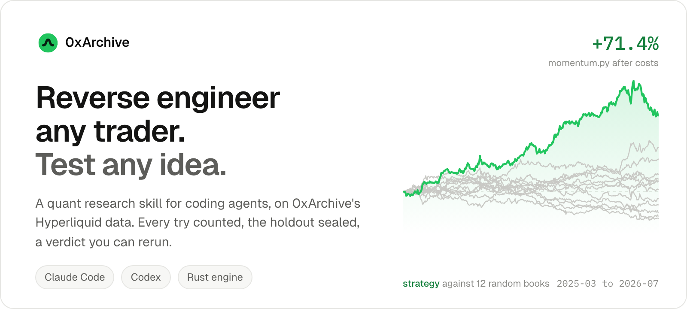
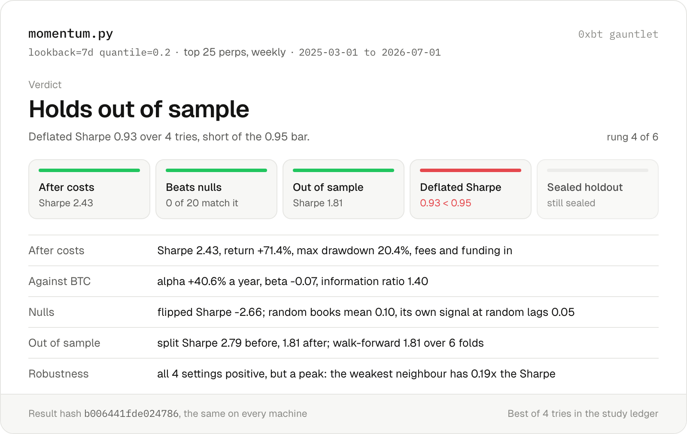
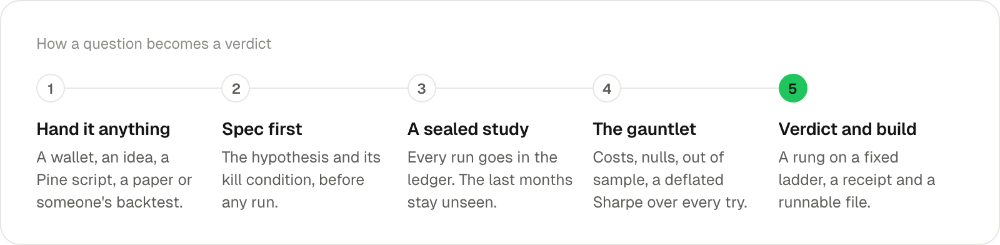

<div align="center">

<picture>
  <source media="(prefers-color-scheme: dark)" srcset="assets/readme/hero-dark.png">
  
</picture>

   

[Install](#install) · [How it works](#how-it-works) · [The verdict](#the-verdict) · [Showcases](#showcases) · [Market data skill](#market-data-skill-0xarchive) · [Docs](https://docs.0xarchive.io)

</div>

Hand your coding agent a wallet, a trading idea, a Pine script, a paper or someone else's backtest. It comes back the way a careful quant desk would: a spec, the cheapest evidence first, a backtest with every cost in, and a verdict read off fixed rules, with a receipt anyone can rerun.

```text
/0xarchive-backtest is 7-day momentum on the top 25 perps real, or luck?
```

<div align="center">

<picture>
  <source media="(prefers-color-scheme: dark)" srcset="assets/readme/card-dark.png">
  
</picture>

</div>

<sub>A real run: the engine's momentum example, 2025-03 to 2026-07, through `0xbt gauntlet`. It beats every null and holds out of sample, but four tries is enough for luck to explain a Sharpe like its own, so the verdict stops at rung 4.</sub>

## Highlights

- **Reverse engineer any trader.** Pull a wallet's fills, profile its style, ask whether it was skill or luck, and score candidate rules by how much of the book they reproduce.
- **Every try counted.** A trial ledger records every backtest the agent runs, and the deflated Sharpe counts all of them, so the tenth tweak can't pass as the first.
- **The holdout stays sealed.** The last months of data can't be read until one candidate is committed, once.
- **A verdict from fixed rules,** never the agent's mood: costs, nulls, out of sample, walk-forward, deflated Sharpe, sealed holdout.
- **Receipts.** A deterministic Rust engine: the same strategy, data and parameters give the same result hash on every machine.
- **Your data, your key.** `0xbt data pull` builds a minute dataset of Hyperliquid perps from the 0xArchive API: prices, taker flow, funding, open interest, liquidations and order activity.

## Install

```bash
git clone https://github.com/0xArchiveIO/0xarchive-quant.git

# Claude Code (Codex: .agents/skills instead)
mkdir -p .claude/skills
cp -R 0xarchive-quant/skills/backtest .claude/skills/0xarchive-backtest

# The engine: Rust, built once (needs cargo, https://rustup.rs)
pip install ".claude/skills/0xarchive-backtest/engine/crates/py[curated]"

# Data, with your key
export OXARCHIVE_API_KEY="0xa_your_api_key"
0xbt data pull --markets BTC,ETH,SOL --from 2025-06 --to 2026-09
```

Then ask in Claude Code with `/0xarchive-backtest`, or in Codex with `$0xarchive-backtest`. Free keys read the last 30 days; longer backtests need a [paid plan](https://www.0xarchive.io/pricing).

## How it works

<div align="center">

<picture>
  <source media="(prefers-color-scheme: dark)" srcset="assets/readme/flow-dark.png">
  
</picture>

</div>

The skill routes what you hand it, writes the spec before any run, and keeps every run in a study whose last months stay sealed. A few things to ask:

| Ask | What happens |
|---|---|
| "reverse engineer 0x..." | Pulls the wallet's position changes, profiles its style, runs its book through the engine, tests skill against luck, and scores candidate rules by how much of the book they reproduce |
| "does a funding flip predict a reversal?" | Writes the claim as a spec with a kill condition, runs an event study, then a strategy through the gauntlet |
| "port this Pine script" | Ports it to the strategy API, checks the port bar by bar, then tests it |
| "audit backtest.py" | Lists lookahead, survivorship, cost and fill problems line by line, then reruns it honestly |
| "find me something in cross-sectional momentum" | A declared search with a trial budget, then one candidate committed to the sealed holdout |

## The verdict

Every study ends on one rung, the first whose rule fails. The rules are code in the engine, not the agent's judgment.

| Rung | Verdict | Reached when |
|---|---|---|
| 1 | **loses after costs** | Sharpe at or below 0 after fees and funding |
| 2 | **fails nulls** | the flipped signal does as well, or over 5% of random or stale runs match it |
| 3 | **in-sample only** | the split or walk-forward Sharpe is at or below 0 |
| 4 | **holds out of sample** | the deflated Sharpe over every try is under 0.95 |
| 5 | **passes deflated Sharpe** | not yet tested on the sealed holdout |
| 6 | **passes sealed holdout** | the committed candidate made money on months nobody had seen |

## Showcases

**Is momentum real?** The engine's 7-day momentum over the top 25 perps, 2025-03 to 2026-07: Sharpe 2.43 after costs, alpha 41% a year against BTC, no random or stale null matched it, Sharpe 1.81 out of sample. Verdict **holds out of sample**: over four tries its deflated Sharpe is 0.93, and the card says the best setting is a peak, not a plateau. Result hash `b006441fde024786`.

**Can it find a trader's rules?** A test where the answer is known: a book of 297 position changes across 10 markets, made by one of the engine's example strategies and written in the API's wallet format. Mirrored through the engine and scored against two candidates:

| Candidate | Same side as the trader | Daily return correlation |
|---|---|---|
| The rules that made the book | 100% of held hours | 0.97 |
| An unrelated strategy | 2.5% | -0.02 |

The mirror's random and stale nulls redraw at the trader's own holding period (detected: 168 hours), so "skill or luck" compares like with like.

## Market data skill: 0xarchive

The original skill: one authenticated request to one live market-data answer, with no runtime dependency beyond `curl` and `jq`.

0xArchive is granular market data infrastructure for two venues: Hyperliquid and Lighter. Hyperliquid includes core perps, HIP-3 builder perps, HIP-4 outcome markets, and Hyperliquid Spot; HIP-3, HIP-4, and Spot stay under the Hyperliquid namespace. Lighter has two deployments: mainnet (`/v1/lighter`) and Robinhood Chain (`/v1/rh-lighter`, USDG-quoted perps and spot such as `AAPL-USDG`). Account positions are available on Hyperliquid core, HIP-3, and both Lighter deployments.

Use this skill when Claude Code, ChatGPT Codex, or another local skill-capable coding agent needs the fastest route from `X-API-Key` to one live market-data answer. Use [AI Clients](https://docs.0xarchive.io/ai-clients) to choose between skills, MCP, CLI, markdown docs, `llms.txt`, OpenAPI, and other Claude Code or ChatGPT Codex routes.

```bash
git clone https://github.com/0xArchiveIO/0xarchive-quant.git

# Claude Code: project skill
mkdir -p .claude/skills/0xarchive
cp 0xarchive-quant/skills/query/SKILL.md .claude/skills/0xarchive/SKILL.md

# ChatGPT Codex: repo-scoped skill
mkdir -p .agents/skills/0xarchive
cp 0xarchive-quant/skills/query/SKILL.md .agents/skills/0xarchive/SKILL.md

export OXARCHIVE_API_KEY="0xa_your_api_key"
```

For a skill available in every project, copy it to `~/.claude/skills/0xarchive/` (Claude Code) or `~/.agents/skills/0xarchive/` (ChatGPT Codex) instead. With OpenClaw: `openclaw install 0xarchive`.

### First answer

The skill is named `0xarchive`. How you call it depends on the client:

| Client | Call it with | Example |
| --- | --- | --- |
| Claude Code | `/0xarchive` | `/0xarchive BTC funding rate` |
| ChatGPT Codex CLI or IDE extension | `$0xarchive`, or pick it from `/skills` | `$0xarchive BTC funding rate` |

Both clients can also load the skill on their own when a request matches its description, so a plain question such as "What is the BTC funding rate on Hyperliquid?" works too.

Expected result: current or recent 0xArchive market data, or a direct auth/configuration error.

### Agent Integration Requirements

| Agent surface | Requirement | Setup mechanic |
| --- | --- | --- |
| Claude Code | Local skills enabled | Copy the skill into `.claude/skills/0xarchive` |
| ChatGPT Codex | ChatGPT Codex with skills enabled | Copy the skill into `.agents/skills/0xarchive` in the target repo, or into `~/.agents/skills/0xarchive` for every repo |
| Both coding agents | `OXARCHIVE_API_KEY`, `curl`, and `jq` | Ask one question first, then expand into CLI, MCP, SDKs, or Data Catalog exports |
| OpenClaw | Optional install helper | `openclaw install 0xarchive` |
| No local skill support | Shell, MCP, or docs access | Use the CLI, MCP where supported, SDKs, `llms.txt`, OpenAPI, or markdown docs |

### Claude Code And ChatGPT Codex

Claude Code and ChatGPT Codex should both start from the same 0xArchive product truth: one authenticated request first, then expand into deeper tooling only after the result is concrete. Use this SKILL.md package directly in skill-capable clients. When a client does not support local skills, use the same API key through the CLI, SDKs, MCP where supported, [llms.txt](https://www.0xarchive.io/llms.txt), [OpenAPI](https://www.0xarchive.io/openapi.json), and markdown docs.

### Usage Examples

Shown in the Claude Code form. In ChatGPT Codex, write `$0xarchive` in place of `/0xarchive`.

| Command | What you get |
|---------|-------------|
| `/0xarchive BTC funding rate` | Current funding rate for BTC |
| `/0xarchive ETH 4h candles last week` | Historical OHLCV candles |
| `/0xarchive SOL liquidations last 24h` | Recent liquidation events |
| `/0xarchive xyz:SP500 trades last hour` | Hyperliquid HIP-3 trades |
| `/0xarchive system health` | Data quality status across venue APIs |
| `/0xarchive BTC open interest on Lighter` | Lighter open-interest history |
| `/0xarchive AAPL-USDG orderbook on Lighter Robinhood Chain` | Lighter on Robinhood Chain L2 order book |
| `/0xarchive positions for wallet 0x...` | Current Hyperliquid positions and account summary |
| `/0xarchive largest BTC longs` | Market-wide positions for one symbol, largest first |
| `/0xarchive HIP-4 outcome candles last day` | HIP-4 implied-probability OHLCV |
| `/0xarchive verify wallet 0x...` | SIWE sign-in for an existing wallet account |

### Data Available

- **Orderbooks** -- Hyperliquid-family native L2 is capped at 20 levels per side. Lighter native L2 includes all served levels on both deployments; Lighter on Robinhood Chain order books begin August 22, 2026.
- **L4 Orderbooks** -- All-level user-attributed reconstruction, diffs, and checkpoints across Hyperliquid core, Spot, HIP-3, and HIP-4.
- **L3 Orderbooks** -- Lighter mainnet order-level snapshots with owner filtering, capped at 250 orders per side from March 5, 2026. Lighter on Robinhood Chain has no L3.
- **Orders** -- Order history with user attribution, order flow aggregation, and TP/SL history on Hyperliquid families, separate from the resting L4 book.
- **Trades** -- Fill-level rows. Per-fill Lighter trade rows begin January 17, 2025, exact starts vary by market, and maker/taker context is included where served. Lighter on Robinhood Chain trades begin June 26, 2026. Both Lighter deployments serve finalized trades up to `meta.finalized_through` and preliminary rows on `/recent`. HIP-3 trades begin October 13, 2025.
- **Candles** -- OHLCV aggregations from 1m to 1w where served. Lighter candles begin August 1, 2025; Lighter on Robinhood Chain candles begin June 26, 2026; HIP-4 implied-probability candles begin May 2, 2026; Hyperliquid Spot candles begin exactly 2025-03-22T10:50:00Z and accept a maximum limit of 10,000 with opaque cursors.
- **Funding Rates** -- Hyperliquid core at roughly one minute. HIP-3 begins February 16, 2026; Lighter begins August 25, 2025. Both update at roughly 10 seconds. Lighter on Robinhood Chain perps begin August 22, 2026. HIP-4 and Spot have no funding.
- **Open Interest** -- Hyperliquid core, HIP-3, Lighter, and HIP-4 outcome-side OI. HIP-3 begins February 16, 2026; Lighter begins August 25, 2025; Lighter on Robinhood Chain perps begin August 22, 2026; HIP-4 begins May 2, 2026 and updates at roughly 10 seconds.
- **Liquidations** -- Completed-event history on Hyperliquid and HIP-3; Lighter live-captured liquidation-event and aggregated-volume routes from June 10, 2026; Lighter on Robinhood Chain liquidations from June 26, 2026, the venue's first trade, with rows before August 22, 2026 backfilled from the venue's finalized export.
- **Account Positions** -- Open perp positions by Hyperliquid wallet or Lighter account index: current, as of any instant, hourly history, a fill-by-fill change log, account summaries, and market-wide positioning. Change logs begin May 25, 2025 (Hyperliquid core), October 13, 2025 (HIP-3), January 17, 2025 (Lighter mainnet), and June 26, 2026 (Lighter on Robinhood Chain). Billed like trades: one credit per 1,000 rows.
- **WebSocket** -- Live and replay support is channel-specific. Lighter orderbook, trades, open interest, and funding stream live on `wss://api.0xarchive.io/ws` for both deployments (`lighter_*` and `rh_lighter_*`); Lighter candles and L3 orderbooks are replay-only. L4 channels stream live and replay on Hyperliquid core, HIP-3, HIP-4, and Spot, and the full-depth order book channels (`orderbook_full`, `hip3_orderbook_full`) do the same on Hyperliquid core and HIP-3. HIP-4 order book and open interest channels are replay-only, and Spot TWAP is served over REST only. `GET /v1/capabilities` lists live and replay support per venue and data type.
- **Price History** -- Mark, oracle, and mid price over time
- **Freshness** -- Per-data-type lag and last-updated timestamps
- **Market Summary** -- Price, funding, OI, volume, and liquidations in one call
- **Data Quality** -- Coverage, latency, SLA, incidents

### Data Catalog

For file-based historical pulls, use the [Data Catalog](https://www.0xarchive.io/data). It lets you search markets, choose datasets and dates, see a live quote, and export zstd-compressed Parquet. Lighter on Robinhood Chain exports use the exchange key `rh-lighter` with L2 order book, trades, funding, and open-interest data.

### Links

- [API Docs](https://docs.0xarchive.io)
- [Python SDK](https://github.com/0xArchiveIO/sdk-python)
- [TypeScript SDK](https://github.com/0xArchiveIO/sdk-typescript)
- [Rust SDK](https://github.com/0xArchiveIO/sdk-rust)
- [CLI](https://github.com/0xArchiveIO/0xarchive-cli)
- [MCP Server](https://docs.0xarchive.io/mcp-server)
- [Examples](https://github.com/0xArchiveIO/examples)

### Requirements

- An 0xArchive API key from [signup](https://www.0xarchive.io/signup)
- `curl` and `jq` available in your shell

### Next Paths

- First authenticated route: [Quick Start](https://docs.0xarchive.io/quickstart)
- Skill/MCP/agent choice: [AI Clients](https://docs.0xarchive.io/ai-clients)
- CLI for Claude Code, ChatGPT Codex, and other shell-first agent work: [CLI docs](https://docs.0xarchive.io/cli)
- Plans and limits: [Pricing](https://www.0xarchive.io/pricing)
- Status and changes: [Status](https://www.0xarchive.io/status), [Changelog](https://www.0xarchive.io/changelog)

## License

MIT, including the backtest engine.
